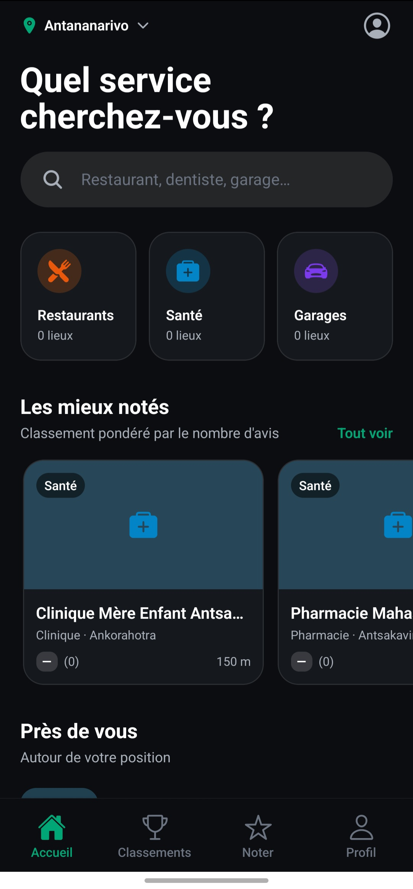
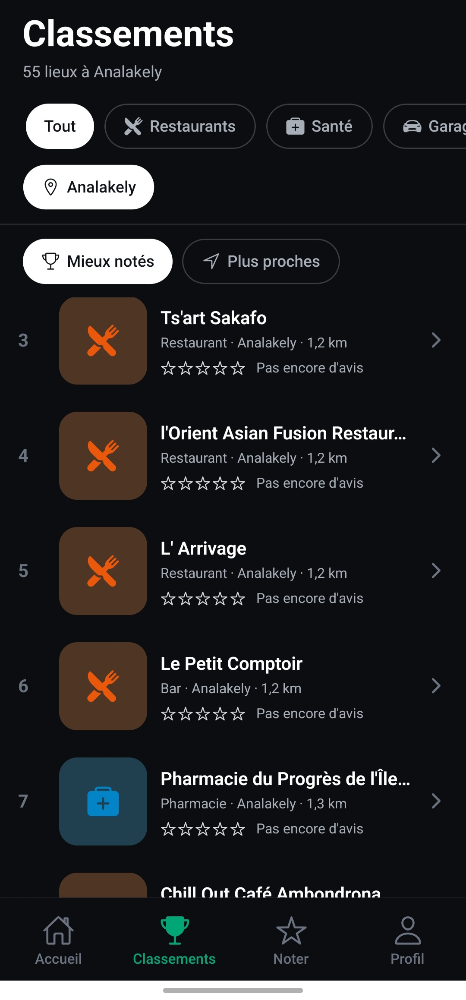
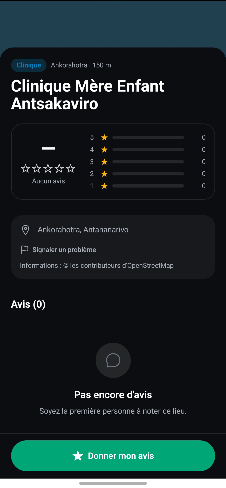

# Noteo

Mobile app to find and review the best local services in Madagascar.
*"Noteo" comes from Malagasy, meaning "rate it".*

The MVP focuses on Antananarivo and three categories (restaurants, health, garages), and answers one simple question: **what's the best-rated place near me, in this category?**

## Features

- Browse places by category and district, sorted by rating
- Location-based results ("near me") with Expo Location
- User-proposed places, confirmed once they receive 3 on-site reviews
- Place catalogue imported from OpenStreetMap into Supabase
- Responsive layout with a sidebar navigation on desktop (web)

## Tech stack

- **Expo** · **React Native** · **TypeScript**
- **Expo Router** (file-based routing)
- **NativeWind** (Tailwind CSS for React Native)
- **TanStack Query** for data fetching and caching
- **Supabase**: Postgres + PostGIS, Auth, Storage

## Getting started

    npm install
    npm start

Then scan the QR code with Expo Go (Android or iOS).

## Project status

🚧 Work in progress. Screens and the Supabase catalogue are in place. Next steps: authentication and review submission.

## Screenshots

  
  &nbsp;&nbsp;&nbsp;&nbsp;
  
  &nbsp;&nbsp;&nbsp;&nbsp;
  

